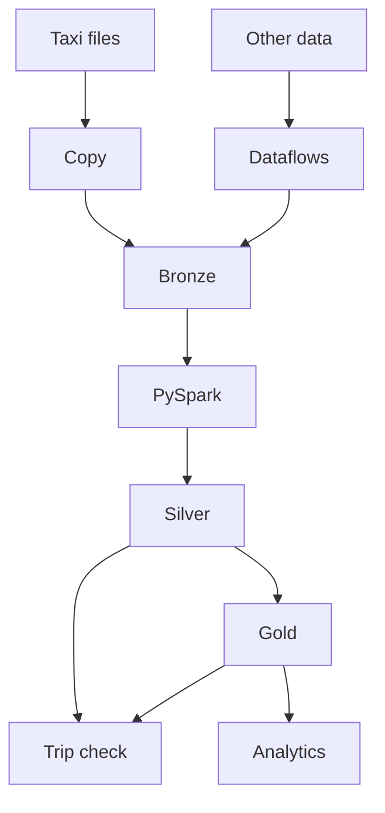

# NYC Urban Analytics

NYC Urban Analytics is a Microsoft Fabric data engineering project that combines New York City Yellow Taxi trips, air-quality measurements, exchange rates, and US GDP. It uses a Bronze, Silver, and Gold architecture to answer questions about trip volumes, fares, pickup zones, and how taxi activity and air quality varied by date and borough.

The analysis uses **January and February 2022 and 2024**. The current Gold snapshot contains **11,415,362 trips** and **761 daily air-quality records**. The refresh pipeline was tested through a scheduled run in Fabric.

## Data sources

| Data | Coverage in the project | Ingestion | Source |
| --- | --- | --- | --- |
| Yellow Taxi trips | January and February 2022 and 2024 | Monthly Parquet files copied to Bronze by `pl_ingest_bronze` | [NYC TLC Trip Record Data](https://www.nyc.gov/site/tlc/about/tlc-trip-record-data.page) |
| Taxi zones | 265 zone records | CSV lookup ingested by `df_ingest_taxi_zones` | [NYC TLC Taxi Zone Lookup](https://d37ci6vzurychx.cloudfront.net/misc/taxi_zone_lookup.csv) |
| PM2.5 | Daily readings in µg/m³ from stations in Manhattan, the Bronx, and Queens, with coverage varying by station and year | Historical API JSON files staged in Bronze and read by `df_ingest_openaq` | [OpenAQ measurements](https://docs.openaq.org/resources/measurements) |
| NO₂ | Daily readings in ppb from NYC monitoring stations in the Bronx and Queens | Filtered historical AirData CSV files staged in Bronze and read by `df_ingest_epa_no2` | [EPA AirData downloads](https://aqs.epa.gov/aqsweb/airdata/download_files.html) |
| EUR to USD exchange rates | ECB observations from December 31, 2021 through February 29, 2024 | Web source ingested by `df_ingest_ecb_fx` | [ECB euro reference rates](https://www.ecb.europa.eu/stats/policy_and_exchange_rates/euro_reference_exchange_rates/html/index.en.html) |
| US GDP | Annual nominal GDP in US dollars, 2000–2024 in the project snapshot | World Bank API ingested by `df_ingest_worldbank_gdp` | [World Bank GDP indicator](https://data.worldbank.org/indicator/NY.GDP.MKTP.CD?locations=US) |

## Architecture

The taxi branch copies NYC TLC Parquet files. The other branch uses Dataflow Gen2 for air quality, exchange rates, GDP, and taxi zones. The Fabric items for the three layers are `lh_bronze`, `lh_silver`, and `wh_gold`. The trip check compares Silver and Gold, and the analytics notebook reads Gold.

**Bronze** holds the original taxi files, staged air-quality extracts, and raw tables written by the dataflows. **Silver** holds typed Delta tables. `nb_02_transform_taxi` removes exact duplicates, aligns incoming files with the Silver schema, and writes one source-month partition at a time. `nb_03_transform_reference_data` prepares the air-quality, exchange-rate, GDP, and taxi-zone tables.

**Gold** reads the Silver SQL analytics endpoint and builds the tables used by the analytics notebook. `FactTaxiDaily` keeps monetary sums and eligible trip counts so monthly averages can be calculated across days and zones. Zero-distance trips remain in the trip count. The average-distance metric uses trips with a positive distance.

| Gold table | Grain |
| --- | --- |
| `dbo.FactTaxiDaily` | One row per date and pickup zone |
| `dbo.FactAirQualityDaily` | One row per source-specific sensor or monitor and local date |
| `dbo.DimDate` | One row per calendar date |
| `dbo.DimZone` | One row per TLC zone ID |
| `dbo.DimFX` | One row per calendar date and currency pair |
| `dbo.DimGDP` | One row per country and year |

## Run the pipeline

1. Open **NYC Urban Analytics** in Fabric and verify that its capacity is active. In a new workspace, the Fabric items are tracked under `fabric/`. Configure the workspace connections before running and keep the item names used by the SQL scripts.
2. For a fresh setup, stage the five OpenAQ JSON extracts in `lh_bronze/Files/openaq_pm25/` as `openaq_pm25_<sensor_id>_<year>_jan_feb.json`. The batches use sensors `673` and `1102` for 2022 and sensors `673`, `1102`, and `1152` for 2024. Stage the two EPA CSV extracts in `lh_bronze/Files/epa_no2/` as `epa_no2_nyc_<year>_jan_feb.csv`. They contain January–February NYC records for NO₂ parameter `42602`.
3. Open `pl_refresh_urban_analytics` and select **Run**. Use `source_year = 2024` and `source_month = 2` to reproduce the tested refresh. To build the full taxi snapshot in an empty workspace, run it once for each of `2022-01`, `2022-02`, `2024-01`, and `2024-02`.
4. Open **View run history**. The last activity, `validate_gold_taxi_daily`, compares trip and day counts by month between Silver and Gold. It raises a SQL error when a month differs or the comparison is empty.
5. Open `nb_04_analyze_gold` and select **Run all** to regenerate the analysis from Gold.

The pipeline refreshes the selected taxi month and processes the reference dataflows, transforms their outputs in Silver, syncs the Silver SQL endpoint, rebuilds the Gold tables, and runs the taxi reconciliation. Rerunning a taxi month replaces that partition in Silver.

The tested schedule was configured for **Tuesdays at 18:40 (UTC+05:00)** with `source_year = 2024` and `source_month = 2`. The scheduled run completed with `Succeeded`. The capacity must be active when the schedule fires.

## Validation

| Source month | Days in Gold | Silver trips eligible for Gold | Gold trips | Difference |
| --- | ---: | ---: | ---: | ---: |
| 2022-01 | 31 | 2,463,879 | 2,463,879 | 0 |
| 2022-02 | 28 | 2,979,367 | 2,979,367 | 0 |
| 2024-01 | 31 | 2,964,606 | 2,964,606 | 0 |
| 2024-02 | 29 | 3,007,510 | 3,007,510 | 0 |

The air-quality fact contains **293 PM2.5** and **468 NO₂** daily records in the validated snapshot. Gold has a valid EUR/USD rate for **all 790 days** in its current calendar. On days without a published rate, Gold carries forward the most recent available ECB rate. The notebook converts each day's USD total at that day's rate before aggregating to a month.

## Analytics

`nb_04_analyze_gold` shows trip counts by day and borough, the busiest pickup zones, metered fares, and total trip amounts in USD and EUR. It compares pollution across stations and years. The `DimGDP` table provides annual US economic context.

- The air-quality comparison matched calendar days with at least 75% observation coverage in both years. Average concentration was lower in 2024 on both comparable PM2.5 sensors and on three of the four comparable NO₂ monitors.
- The borough analysis matched **721 station-day readings** with same-day taxi pickups. At the IS 52 NO₂ monitor in the Bronx, Pearson's correlation with pickups was **0.425 in 2022** and **0.333 in 2024**. These correlations describe how the two measures varied together during the observed periods.

## Extend the project

- For a taxi month within the configured calendar, change `source_year` and `source_month` and rerun the pipeline. Review the source schema if TLC introduces or changes fields.
- To add dates beyond February 2024, extend the date range in `01_load_dim_date_and_zone` and its matching pipeline Script activity, and extend the extraction window in `df_ingest_ecb_fx`. Update the notebook's date filters for analyses that should include the new months.
- To expand air-quality coverage, stage the new source extracts, update the input selections in the relevant dataflows and the sensor-to-borough mapping used in the analysis, then verify daily coverage before comparing periods.
